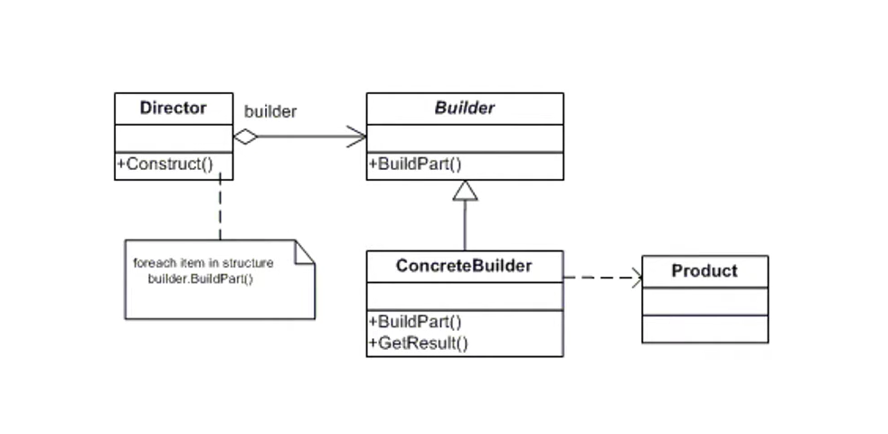

# Builder Pattern - Processando uma NFSe Nacional

## Referências:
- [Arquivo de integração TX2 - NFSe Padrão Nacional (TecnoSpeed)](https://atendimento.tecnospeed.com.br/hc/pt-br/articles/12263343956375-Arquivo-de-integra%C3%A7%C3%A3o-TX2-NFSe-Padr%C3%A3o-Nacional)

## Diagrama de Classes do Builder Pattern

## Objetivo

Este projeto demonstra o Builder Pattern, um padrão criacional que organiza a construção de objetos complexos em etapas.

No exemplo, utilizei esse padrão para montar os dados de uma NFSe no padrão nacional em formato TX2(transmissão de dados específica via arquivo .txt). A interface [iNFSeBuilder](NFSeNacionalBuilder/iNFSeBuilder.cs) define as etapas de construção, e [NFSeBuilder](NFSeNacionalBuilder/NFSeBuilder.cs) implementa essas etapas. Assim, a montagem do conteúdo fica separada do fluxo que coordena o processamento.

## Como funciona

O [BackgroundDirector](NFSeNacionalDirector/BackgroundDirector.cs) é um `BackgroundService` que verifica a fila de processamento a cada cinco minutos. Em cada execução, consulta as notas com status `PENDENTE` e, para cada uma, solicita ao builder o cabeçalho e os dados da DPS em TX2.

O fluxo representa os papéis do padrão da seguinte forma:
- **Builder:** [iNFSeBuilder](NFSeNacionalBuilder/iNFSeBuilder.cs), que define as etapas disponíveis.
- **Concrete Builder:** [NFSeBuilder](NFSeNacionalBuilder/NFSeBuilder.cs), que monta o cabeçalho e os dados da DPS.
- **Director:** [BackgroundDirector](NFSeNacionalDirector/BackgroundDirector.cs), que coordena a consulta das notas e a chamada das etapas do builder.
- **Produto:** [NFSeNacional](Data/NFSeNacional.cs), objeto com os dados usados para compor o TX2.

## Estado atual

Atualmente, o projeto monta o conteúdo TX2 da DPS. O envio para processamento ainda está indicado como uma etapa futura no código. As etapas de deduções e documentos referenciados foram apenas referenciadas, não são necessárias para entendimento do método.