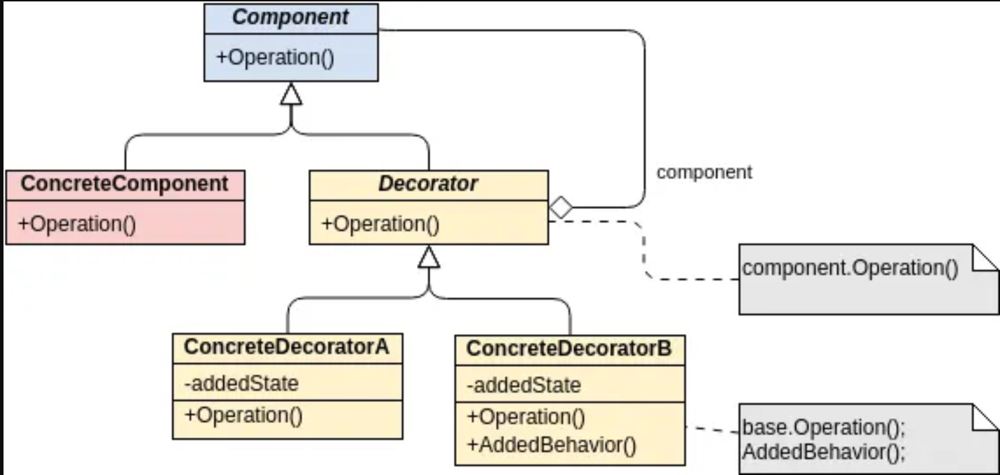
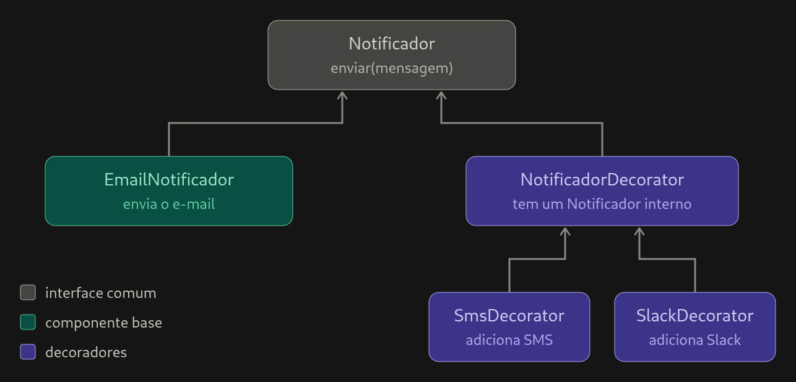
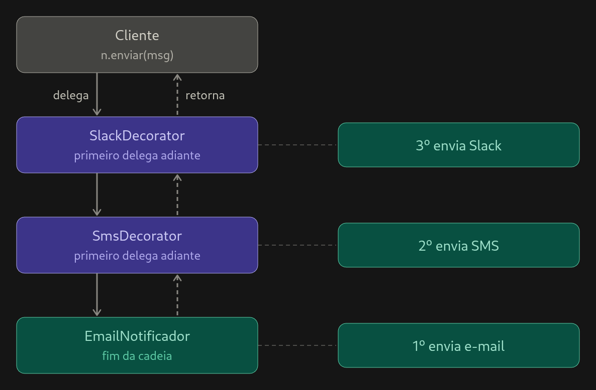

# Decorator Pattern - Serviço SMTP

## Referências:
- [Twilio Helpers](https://www.twilio.com/docs/libraries/reference/twilio-csharp/index.html)
- [WhatsApp / SMS - Twilio](https://jussiroine.com/2020/05/building-a-notification-tool-using-net-core-twilio-and-whatsapp-messages/)
- [Slack - SlackBotMessages](https://github.com/prjseal/SlackBotMessages)

## Diagrama de Classes do Decorator

## Objetivo

O padrão Decorator trabalha com a agregação, esta  permite adicionar comportamentos à um objeto dinamicamente.

Diferentemente de herança que trata de classes filho que herdam características através de herança da classe pai, de forma diferente, a agregação trabalha com uma relação direta entre Cliente e Serviço.

Neste contexto, o padrão do serviço é decorado e aplicado diversas maneiras ao longo do processo.

## Como funciona

### Diagrama Simplificado

### Fluxo

## Objetos do padrão no projeto

- **Interface geral (Component):** [iNotificador](ServicoRedirecionamentoSMTP/pattern/interfaces/iNotificador.cs) define as operações comuns. O componente e os decorators seguem o mesmo contrato.
- **Componente concreto:** [EmailComponent](ServicoRedirecionamentoSMTP/pattern/components/EmailComponent.cs) cria e envia mensagens por SMTP. É o serviço base do exemplo.
- **Decorator base:** [NotificadorBaseDecorator](ServicoRedirecionamentoSMTP/pattern/decorators/NotificadorBaseDecorator.cs) recebe outro `iNotificador` e repassa as chamadas. Essa classe permite encadear notificadores.
- **Decorators concretos:** [SMSConcreteDecorator](ServicoRedirecionamentoSMTP/pattern/decorators/SMSConcreteDecorator.cs), [WhatsAppConcreteDecorator](ServicoRedirecionamentoSMTP/pattern/decorators/WhatsAppConcreteDecorator.cs) e [SlackConcreteDecorator](ServicoRedirecionamentoSMTP/pattern/decorators/SlackConcreteDecorator.cs) representam canais adicionais.

Neste projeto, a ideia é combinar os canais em camadas, como `Slack(WhatsApp(SMS(Email)))`. Gosto dessa abordagem porque cada canal pode ser adicionado sem alterar o componente de e-mail.

## Estado atual

O `Worker` ainda instancia apenas `EmailComponent`. Os decorators não estão ligados ao fluxo e seus métodos são provisórios: retornam string vazia ou `true`. Por enquanto, o projeto mostra a estrutura do padrão, mas não envia notificações por SMS, WhatsApp ou Slack.
